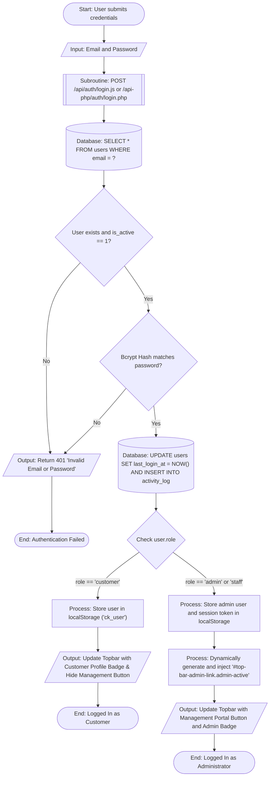
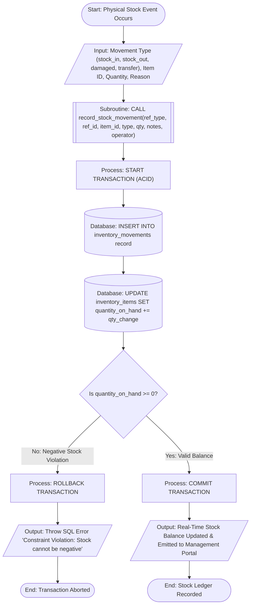

# CreativeKit 3A — Comprehensive System Flowchart & Architecture Specification

> **Project:** CreativeKit 3A Merchandising Platform  
> **Standard:** ANSI / ISO 5807 Standard Flowchart Symbols & Syntax  
> **Database:** MySQL `creativekit3a_db` (InnoDB)  
> **Subsystems:** Storefront, Search, RBAC Auth, Quotation Engine, Purchasing, Inventory, and MIS Dashboard

---

## 1. Standard Flowchart Shape Legend (ANSI / ISO 5807)

This flowchart strictly follows international standard flowcharting shapes and conventions:

| Shape Name | Mermaid Syntax | Visual Representation | Meaning & Functional Purpose |
| :--- | :---: | :---: | :--- |
| **Terminator** | `([ "Start / End" ])` | **Oval / Stadium** | Represents the starting or terminal ending point of a system process. |
| **Input / Output (I/O)** | `[/ "Data Input or Screen Output" /]` | **Parallelogram** | Represents user data entry (forms, search queries) or system output (web pages, toasts, emails). |
| **Process / Operation** | `[ "Execute Task / Calculation" ]` | **Rectangle** | Represents internal computations, variable assignments, state changes, or DOM manipulations. |
| **Decision / Condition** | `{ "Condition Check?" }` | **Diamond / Rhombus** | Represents conditional branching (`Yes` / `No`, `True` / `False`, `Role Check`). |
| **Predefined Process / Subroutine**| `[[ "API Controller / Stored Procedure" ]]` | **Double-Border Box** | Represents an external or modular routine, REST API endpoint, or MySQL stored procedure. |
| **Database Storage** | `[( "Database Table / Persistence" )]` | **Cylinder** | Represents a database table, transaction record, or persistent data store in `creativekit3a_db`. |

---

## 2. Master System Flowchart (With Formal Flowchart Shapes)

This diagram outlines the complete operational lifecycle of CreativeKit 3A, utilizing standard flowchart symbols for every action, decision, database operation, and I/O event.

```mermaid
flowchart TD
    %% START TERMINATOR
    START(["Start: User visits CreativeKit 3A"]) --> DISP_HOME[/"Output: Render Homepage with Hero Carousel and Navigation Bar"/]

    %% AUTH CHECK & RBAC
    DISP_HOME --> CHECK_AUTH{"Is User Logged In in localStorage ('ck_user')?"}

    CHECK_AUTH -->|No: Guest Visitor| GUEST_TOPBAR[/"Output: Display 'Sign In' and 'Register' buttons"/]
    GUEST_TOPBAR --> STRIP_ADMIN["Process: Remove '#top-bar-admin-link' from DOM and enforce CSS guard"]

    CHECK_AUTH -->|Yes: Authenticated| CHECK_ROLE{"User Role == 'admin' or 'staff'?"}
    CHECK_ROLE -->|No: Customer| CUST_TOPBAR[/"Output: Display Customer Name Badge and 'Sign Out' button"/]
    CHECK_ROLE -->|Yes: Admin / Staff| INJECT_ADMIN["Process: Dynamically inject Management Button with class '.admin-active'"]
    INJECT_ADMIN --> ADMIN_TOPBAR[/"Output: Display Management Portal Link, Admin Badge and 'Sign Out'"/]

    %% USER ACTION SELECTION
    STRIP_ADMIN --> CHOOSE_ACTION{"User Action Selection"}
    CUST_TOPBAR --> CHOOSE_ACTION
    ADMIN_TOPBAR --> CHOOSE_ACTION

    %% PATH A: PRODUCT SEARCH & CATALOG BROWSING
    CHOOSE_ACTION -->|Search or Browse Categories| INP_SEARCH[/"Input: User types in Search Bar or clicks Category in Mega Menu"/]
    INP_SEARCH --> IS_SEARCH_QUERY{"Was a text search keyword entered?"}

    IS_SEARCH_QUERY -->|Yes: Search Input| ON_CAT_PAGE{"Already on Category Page?"}
    ON_CAT_PAGE -->|Yes| LIVE_FILTER[["Subroutine: Dispatch input event to live filter DOM product cards"]]
    ON_CAT_PAGE -->|No| REDIR_SEARCH["Process: Redirect to category-page.html?s=keyword or .php?s=keyword"]

    IS_SEARCH_QUERY -->|No: Category Click| REDIR_CAT["Process: Redirect to category-page.html?cat=slug or .php?cat=slug"]

    REDIR_SEARCH --> CAT_CONTROLLER[["Subroutine: Execute Category Controller (category-page.js / .php)"]]
    REDIR_CAT --> CAT_CONTROLLER

    CAT_CONTROLLER --> DB_CHECK{"Is Database Connection Available?"}
    DB_CHECK -->|Yes: PHP MySQL| SQL_FETCH[("Database: SELECT products, categories, variants FROM creativekit3a_db")]
    DB_CHECK -->|No: Static Vercel| STATIC_FETCH["Process: Load Fallback STATIC_CATEGORY_DATA"]

    SQL_FETCH --> DISP_CAT_GRID[/"Output: Render Product Grid, Subcategory Tabs, and Hero Stats"/]
    STATIC_FETCH --> DISP_CAT_GRID
    LIVE_FILTER --> DISP_CAT_GRID

    DISP_CAT_GRID --> INP_CLICK_PROD[/"Input: User clicks on a Product Card"/]
    INP_CLICK_PROD --> REDIR_PROD["Process: Navigate to car-charger-adapters.html?item=slug (or .php)"]
    REDIR_PROD --> DISP_VARIANTS[/"Output: Render Product Hero, Variant Tabs (Single/Dual), Specs and Pricing"/]

    %% PATH B: 3-STEP QUOTATION LEAD PIPELINE
    DISP_VARIANTS --> INP_CLICK_QUOTE[/"Input: User clicks 'Request a Quote' Button"/]
    CHOOSE_ACTION -->|Direct Quote Request| INP_CLICK_QUOTE

    INP_CLICK_QUOTE --> DISP_MODAL_STEP1[/"Output: Display Quote Modal Step 1 (Contact Info)"/]
    DISP_MODAL_STEP1 --> INP_STEP1[/"Input: User enters Full Name, Company, Email, Mobile Phone"/]
    INP_STEP1 --> VAL_STEP1{"Are contact fields valid?"}
    VAL_STEP1 -->|No| ERR_STEP1[/"Output: Display Field Validation Errors"/]
    ERR_STEP1 --> INP_STEP1

    VAL_STEP1 -->|Yes| DISP_MODAL_STEP2[/"Output: Display Quote Modal Step 2 (Product & Volume Specs)"/]
    DISP_MODAL_STEP2 --> INP_STEP2[/"Input: User enters Target Product, Quantity, Budget, Deadline"/]
    INP_STEP2 --> VAL_STEP2{"Is Quantity >= 1?"}
    VAL_STEP2 -->|No| ERR_STEP2[/"Output: Display Minimum Quantity Error"/]
    ERR_STEP2 --> INP_STEP2

    VAL_STEP2 -->|Yes| DISP_MODAL_STEP3[/"Output: Display Quote Modal Step 3 (Customization & Details)"/]
    DISP_MODAL_STEP3 --> INP_STEP3[/"Input: User specifies Logo imprint, Packaging, and Custom Details"/]
    INP_STEP3 --> INP_SUBMIT_Q[/"Input: User clicks 'Submit Quote Request'"/]

    INP_SUBMIT_Q --> CALL_QUOTE_API[["Subroutine: POST Payload to /api/quote or /api-php/quote.php"]]
    CALL_QUOTE_API --> DB_SAVE_QUOTE[("Database: INSERT INTO quote_requests AND activity_log")]
    DB_SAVE_QUOTE --> DISP_QUOTE_SUCCESS[/"Output: Display Step 4: Success Screen with Reference ID & Email Notification sent"/]

    %% PATH C: SALES STAFF & QUOTATION REVIEW
    DISP_QUOTE_SUCCESS --> STAFF_LOGIN[/"Input: Sales Staff logs in to Portal and opens Quotes Tab"/]
    STAFF_LOGIN --> SQL_LIST_QUOTES[("Database: SELECT * FROM quote_requests WHERE status='new'")]
    SQL_LIST_QUOTES --> STAFF_REVIEW["Process: Staff assigns quote to self (assigned_to = user_id) and sets status = 'reviewing'"]
    STAFF_REVIEW --> CALC_COSTS["Process: Compute volume break discounts, imprint costs and estimated delivery"]
    CALC_COSTS --> DISP_SEND_QUOTE[/"Output: Send Official PDF Quotation Proposal to Customer Email"/]
    DISP_SEND_QUOTE --> SQL_UPDATE_QUOTED[("Database: UPDATE quote_requests SET status = 'quoted'")]

    SQL_UPDATE_QUOTED --> CUST_DECISION{"Does Customer accept the Quotation?"}
    CUST_DECISION -->|Yes| STATUS_ACCEPTED["Process: UPDATE quote_requests SET status = 'accepted' -> Spawn Production Order"]
    CUST_DECISION -->|No| STATUS_DECLINED["Process: UPDATE quote_requests SET status = 'declined'"]

    %% PATH D: ENTERPRISE PURCHASING, INVENTORY & MIS
    CHOOSE_ACTION -->|Admin Management Access| INP_CLICK_MGMT[/"Input: Admin clicks 'Management' Button"/]
    INP_CLICK_MGMT --> GATE_VERIFY{"Verify Admin Session & Role"}
    GATE_VERIFY -->|Unauthorized| DISP_GATE_MODAL[/"Output: Display Security Gatekeeper Modal (Requires Admin Login)"/]
    DISP_GATE_MODAL --> END_BLOCKED(["Stop / Access Denied"])

    GATE_VERIFY -->|Authorized| DISP_ADMIN_PORTAL[/"Output: Display Management Portal Dashboard (MIS, Inventory, Purchasing)"/]

    DISP_ADMIN_PORTAL --> CHECK_INVENTORY{"Stock Level <= Reorder Threshold?"}
    CHECK_INVENTORY -->|No: Stock Healthy| DISP_STOCK_OK[/"Output: Dashboard shows In-Stock Green Indicator"/]
    
    CHECK_INVENTORY -->|Yes: Low Stock Alert| DISP_STOCK_WARN[/"Output: Trigger Low Stock Alert on MIS Executive KPI Cards"/]
    DISP_STOCK_WARN --> INP_CREATE_PO[/"Input: Procurement Officer creates Purchase Order (PO-YYYY-XXXX)"/]
    INP_CREATE_PO --> SQL_SAVE_PO[("Database: INSERT INTO purchase_orders & purchase_order_items with status = 'sent'")]
    
    SQL_SAVE_PO --> GOODS_ARRIVE[/"Input: Supplier manufactures and delivers goods to Taguig/Cebu Warehouse"/]
    GOODS_ARRIVE --> WAREHOUSE_INSPECT["Process: Warehouse Manager inspects shipment and checks packing slip"]
    WAREHOUSE_INSPECT --> CALL_RECEIVE_SP[["Subroutine: CALL receive_purchase_order(po_number)"]]

    CALL_RECEIVE_SP --> DB_RESTOCK_TRANS[("Database: ACID Transaction: Update PO status='received', Increment inventory_items, Insert inventory_movements, Log audit trail")]

    DB_RESTOCK_TRANS --> CALL_MIS_ROLLUP[["Subroutine: Daily MIS Metrics Aggregator (system_metrics_daily)"]]
    CALL_MIS_ROLLUP --> DISP_MIS_METRICS[/"Output: Refresh MIS Real-time Dashboard with Updated Stock Valuation & Spend"/]

    %% TERMINATION POINTS
    STATUS_ACCEPTED --> END_SUCCESS(["End: Order Successfully Processed & Logged"])
    STATUS_DECLINED --> END_CLOSED(["End: Lead Inactive / Closed"])
    DISP_STOCK_OK --> END_CONTINUE(["End: System Idle / Listening for Requests"])
    DISP_MIS_METRICS --> END_CONTINUE
```

---

## 3. Subsystem Process Breakdown (Using Standard Shapes)

### 3.1 Process A: User Authentication & Role-Based Access Control (RBAC)

---

### 3.2 Process B: Inventory Double-Entry Movement Ledger

---
*Document approved for CreativeKit 3A architecture documentation and academic project review.*
